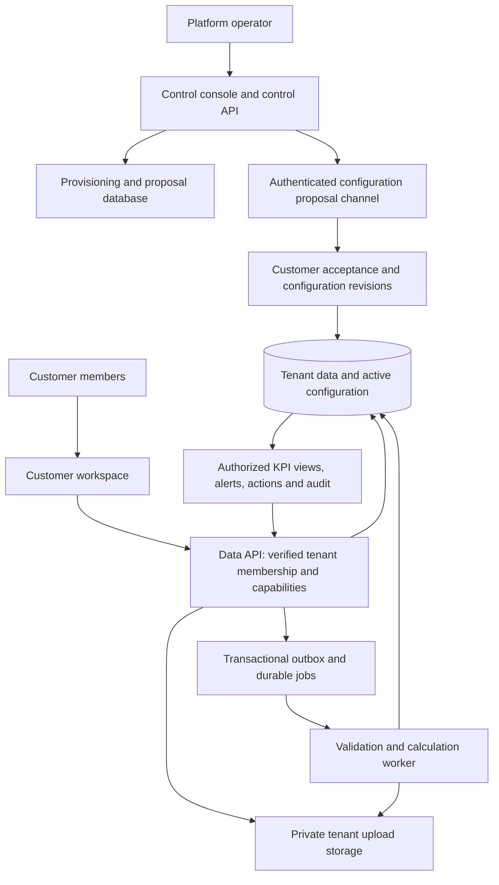

# Architecture — configurable KPI SaaS platform

Date: 15 October 2026
Status: target architecture with a local prototype implementation snapshot (15 October 2026); hosted production architecture remains unverified
Companion: [task.md](saas-tasks.md)

## 1. Honest assessment and product boundary

This is feasible. The supplied project is not yet a general SaaS KPI platform, and this change is a substantial product refactor rather than a rename of hospital labels. Reuse the authentication patterns, contracts discipline, transaction helpers, action lifecycle, and useful UI components. Replace the assumptions that connect roles, KPI definitions, organization hierarchy, and screens to one hospital workbook.

There is already partial custom-role support in `packages/contracts/src/roles.ts`; claiming that the source supports only fourteen literal role names would be inaccurate. However, accepting a custom role string is not enough. `services/api/src/modules/shared.ts` still looks up assignments in the generated framework or a missing industry-template module. `membership.ts` still defines group/region/facility/COE scopes. The latest tenant-role tables still reference the global role registry. End-to-end flexibility is unfinished.

### 1.1 Current implementation snapshot

This is a status statement about the modified source, not proof of a hosted release:

- The active web/API product now exposes a generic KPI workspace, customer invitation flow and separate operator console. The active route registry no longer registers hospital ERP, surveillance or hospital KPI screens. Legacy source and historical migrations are retained for review; old production databases are not migrated or deleted.
- A fresh-project migration adds tenant-scoped organizations, units, custom roles, capability grants, measures, versioned KPI definitions, input batches, approvals, calculated results, actions, audit records, invitations and configuration proposals. Forced RLS and same-tenant foreign keys are in that migration.
- The customer API and control API are configured as separate processes with different database login credentials. Transactions switch into `kpi_app` or `kpi_control_app`. In the current prepared deployment, these schemas still live in the **same Supabase Postgres project/database**. This prevents ordinary operator credentials from querying KPI values; it does not prove the provider or infrastructure administrators cannot access them.
- Formula support is intentionally small: measure references, constants, addition, subtraction, multiplication, division and percentage. Decimal calculations use bounded exact fractions and a fixed publication scale. Missing values remain missing; zero denominators become not applicable. This implementation does not provide general aggregation, weighted rollups, joins, distinct counts, forecasting or arbitrary plugins.
- Inputs can be entered in forms or pasted as CSV aggregate measure values and reviewed by customers; private file upload/storage is not implemented. A durable job queue, connector framework, onboarding email delivery, quotas, offboarding and tested backup/recovery are not complete. Calculations run synchronously on the current API workflow, so pilot scale has not been established.
- Local SQL/RLS and API-path checks use an isolated PGlite database with synthetic identities, plus build, type, lint, unit and browser checks. Hosted Supabase role-grant and RLS behavior remains untested because the requested new project could not be created: the selected Supabase organization is at its Free-plan two-active-project limit.

**Conclusion:** the design can support organizations with different member and role counts when they use supported formulas, but the hosted service and operational scale are not yet demonstrated. This should be called a working prototype, not a ready-to-sell general SaaS product.

The target product is: **organizations define what matters, supply approved inputs, review calculated KPIs, and assign accountable actions.** The platform does not run their operational transactions.

Remove hospital ERP, patient/staff records, attendance, clinical workflows, service billing, hospital simulator, and outbreak surveillance from the core product. External ERP/accounting/CRM systems can become input sources later. Keep generic KPI evidence, targets, alerts, actions, and audit history.

“Any organization” means any organization whose measures and reporting rules fit the supported calculation model. It does not mean every industry formula or every software integration works on day one. New roles and supported formulas must require configuration; new connector protocols and unsupported calculation primitives may still require development.

## 2. What the user should experience

### Platform provisioning

1. A platform operator creates the organization with its name, locale, timezone, reporting calendar, plan, and verified customer owner.
2. The operator selects optional starter templates or proposes role names, hierarchy, KPI definitions, and dashboard layout using synthetic examples.
3. The customer owner accepts the organization invitation and reviews proposed configuration. The platform operator cannot accept the invitation or appoint themselves as a customer user.
4. The customer appoints its own members, data contributors, KPI owners, and approvers. A three-person business and a seven-role enterprise use the same product.
5. The customer connects sources or creates input forms, approves definitions and targets, and submits data. The platform operator cannot open the customer dashboard to inspect values.
6. Approved inputs are calculated and published. Customer members see authorized KPIs, explanations, freshness, and actions.

### Customer navigation

- **Overview:** important KPI changes, missing submissions, overdue actions, freshness.
- **KPIs:** selected metrics, definitions, trends, targets, authorized breakdowns, and lineage.
- **Data:** input forms, imports, source mappings, validation errors, approvals, and reporting deadlines.
- **Actions:** create, assign, acknowledge, progress, submit, approve, cancel.
- **Organization:** members, roles, units, permissions, templates, and reporting settings.
- **Audit:** authorized configuration, input, publication, and action history.

The platform console shows provisioning state, plan, configuration proposals, aggregate resource usage, and sanitized service health. It has no “view as customer,” observation explorer, raw upload preview, or customer export button. Tenant-specific names and definitions can themselves be sensitive; show only the metadata needed for agreed setup work.

## 3. Privacy: define the promise before selling it

Two promises must be distinguished:

| Requirement | Proposed support |
|---|---|
| Platform staff cannot view customer values through their accounts or normal support tools | Required in the managed SaaS product; enforce through separate services, credentials, permissions, and access tests |
| The software provider is technically unable to obtain plaintext, even through infrastructure administration or modified code | Not established by an ordinary provider-hosted database and API; requires a stronger trust/deployment model |

PostgreSQL RLS is an application isolation mechanism. Superusers and roles with `BYPASSRLS` can bypass it; `FORCE ROW LEVEL SECURITY` does not remove all infrastructure-administrator power. [PostgreSQL row security documentation](https://www.postgresql.org/docs/current/ddl-rowsecurity.html).

### Managed SaaS boundary

Use a separate control plane for platform provisioning and a data plane for customer work. Platform operator credentials have no data-plane read privileges. A dedicated runtime service necessarily processes plaintext to calculate KPIs, but human operator accounts do not inherit that service's privileges. Disable routine production SQL access, payload logging, session replay on sensitive screens, and customer-value access in monitoring. Audit privileged infrastructure changes separately from the application.

This supports the statement **“platform administrator accounts cannot access your business data.”** It does not justify “zero knowledge” or “the provider can never access data.” Encryption at rest or a customer-managed key that the provider's service can freely decrypt with does not establish the latter promise.

### Stronger option if inability is literal

Run the data API, database, calculation worker, file storage, and keys in a customer-controlled account/environment. The shared control plane sends configuration proposals; the customer accepts them locally. Providers receive only approved, minimized operational signals. Customer administrators control infrastructure access and approve signed releases; the provider has no standing deployment or decryption credentials. Host the data-handling frontend in that boundary too, so a centrally updated page cannot silently export values.

This has a larger onboarding, support, and upgrade cost. It is still a shared software product, but onboarding is not merely adding a tenant row. Protection against malicious releases also requires customer review and enforced outbound-network controls; calling this cryptographic zero knowledge would still be premature.

**Decision gate:** record which promise customers require before choosing production hosting. The managed design below meets account-level operator separation. If absolute provider inability is mandatory, implement and validate the customer-controlled option before release; do not silently substitute the managed promise.

## 4. System structure



Do not begin with a large microservice estate. Keep React/Vite and Fastify. Use separate control and data service entry points/deployments because their privileges differ, plus one durable background-worker service. Keep shared domain code in packages. Long imports and recalculations run in the worker, not inside a browser request or a short-lived API function.

For managed SaaS, a pooled Postgres data store with tenant IDs and RLS is a reasonable starting deployment. The control database should be separate, with no shared data-reader credential. A later dedicated data store can serve an individual enterprise tenant behind the same interfaces. Pooled, siloed, and mixed deployment models are established alternatives; the choice does not itself determine who can administer the underlying data. [AWS SaaS isolation models](https://docs.aws.amazon.com/wellarchitected/latest/saas-lens/silo-pool-and-bridge-models.html).

Suggested repository responsibilities:

```text
apps/web                 customer KPI workspace
apps/control             platform setup console; no customer-value views
services/api             customer data API
services/control-api     provisioning, templates and proposal delivery
services/worker          import validation, calculations and notifications
packages/contracts       generic, versioned boundary schemas
packages/domain          organization, permission and workflow rules
packages/kpi-engine      formula validation, planning and deterministic evaluation
packages/templates       optional industry templates; healthcare is one template
packages/ui-kit          reusable UI components and tokens
database/control         control-plane migrations
database/tenant          data-plane migrations and isolation tests
```

Folder moves are secondary to establishing the boundaries. Historical migrations remain immutable; deploy additive migrations through the existing migration tool until an intentional tooling migration is reviewed.

## 5. Organizations, people, roles, and permissions

Users, roles, and KPIs are different objects. An organization can have three users and five roles, or one hundred users sharing seven roles. A user can hold multiple role bindings. Business titles are arbitrary display names attached to tenant-owned IDs, not TypeScript enums or global database foreign keys.

Model an organization as a root entity with optional child units. Unit types and labels are tenant configuration: branch, department, factory, team, project, office, or another supported grouping. A flat organization needs only its root. Enforce no cycles, bounded depth, valid same-tenant parents, and effective dates for reorganizations. Non-hierarchical dimensions such as product or channel remain separate from the organization tree.

Business role does not imply administrator access. Capabilities include member management, definition proposal, definition approval, source management, input submission, input approval, KPI read, restricted breakdown read, action assignment, and audit read. Customer owners choose those capabilities. Platform operators are separate identities and never become data-plane members merely because they created an organization.

Bind permissions as tuples: **role binding + action + KPI/measure set + entity scope + allowed breakdown**. Evaluate complete tuples. Do not combine the KPI grant from one role with the entity scope from another and accidentally create wider access. Reporting hierarchy does not automatically grant permission to inspect employee data or lower-level KPIs.

After JWT verification, select an explicit organization, verify the subject's active membership in it, and load its role bindings and scopes. Never accept a tenant ID as authorization by itself. All request, worker, cache, storage, export, and search contexts include that verified tenant. Revoking membership or permissions must invalidate cached authorization and deny subsequent reads/writes. Switching organizations clears prior workspace state and cancels stale requests.

## 6. Data model

This is a logical design, not executable DDL. Every tenant-owned table carries `tenant_id`; all relationships between tenant objects use composite tenant/object foreign keys. RLS applies to read and write paths. The API cannot edit its own privilege context from request-body fields.

| Group | Principal tables and purpose |
|---|---|
| Control | `tenant_registry`, `provisioning_requests`, `configuration_proposals`, `template_versions`, `subscriptions`, `platform_audit` |
| Organization | `tenant_settings`, `entities`, `entity_type_definitions`, effective-dated hierarchy edges/closure, `memberships`, `roles`, `role_bindings`, `permission_grants` |
| Measure semantics | `measure_definitions`, versioned source mappings, approved dimension definitions and members |
| KPI semantics | `kpi_definitions`, immutable `kpi_versions`, `kpi_dependencies`, `kpi_assignments`, `target_versions` |
| Input | `sources`, `upload_batches`, `staging_rows`, `input_facts`, `input_revisions`, `input_approvals`, `period_locks` |
| Processing | `outbox_events`, `jobs`, `calculation_runs`, `kpi_results`, `published_result_sets`, `result_lineage` |
| Work | `dashboard_layouts`, `alerts`, `actions`, `action_events`, `tenant_audit`, notification outbox |

Keep template IDs separate from tenant KPI IDs. Copying a global template creates a tenant-owned definition pinned to a template version. A later template update becomes a proposal, never a silent change to every customer's numbers. Tenant-private definitions are not published to the global catalog without an explicit customer decision.

A KPI assignment links a KPI to a business role/scope/layout; it does not define the formula or own a separate copy of the input. Calculate one canonical result for an approved KPI version, entity, period, and input revision set. Reuse it for each authorized role.

Separate measured facts and dimensions from KPI formulas. Facts record numeric inputs at a declared grain; dimensions describe their context. This distinction makes aggregation explicit and avoids storing only dashboard totals with no basis for reconciliation. [Microsoft guidance on facts, dimensions and measures](https://learn.microsoft.com/en-us/power-bi/guidance/star-schema).

### Minimum contracts

`MeasureDefinition`: tenant, stable ID, label, decimal/unit type, currency where applicable, entity grain, dimension schema, reporting cadence, allowed aggregation across time/entities, expected coverage, source precedence, owner and validation rules.

`KpiVersion`: tenant, stable KPI ID, version, business definition, formula AST, measure/dependency IDs, output unit, permitted scopes, dimensions, time-window policy, missing-data policy, owner, approver, effective dates, immutable checksum and status.

`InputFact`: tenant, measure/version, entity, period/event date, approved dimension tuple, decimal value, source, external record ID, batch, revision, origin, approval status and audit metadata. Multiple sources must follow a declared precedence or reconciliation rule; they cannot silently double-count the same business event.

`KpiResult`: tenant, KPI version, entity, period, decimal value or reason for no value, completeness/freshness, input revision IDs, calculation run, engine version, approved target version, publication time and superseded-result link.

Decimal values travel as decimal strings with explicit units where exact precision matters. Do not use binary floating point for financial rounding rules. Entity identifiers are UUIDs or another consistently validated ID format, not display names.

## 7. KPI lifecycle and calculation

### A KPI requested by a customer

| Situation | Required behavior | Developer involvement |
|---|---|---|
| Existing template fits | Copy/pin template, map inputs, configure target and scope, approve | None per tenant once onboarding exists |
| New KPI uses supported measures/operators | Create tenant definition through the builder; validate, preview, approve | None per KPI |
| Required input is not collected | Create a measure and a form/import mapping; request data | Usually configuration; connector development only if needed |
| Source exists but is inaccessible/unavailable | Show unavailable/pending data and a source task | Integration work may be needed; do not invent a value |
| Formula needs an unsupported operation/model | Explain the unsupported capability; queue a reviewed extension | Yes, engine extension or connector/plugin work |
| Customer supplies only a precomputed value | Accept as an approved externally calculated KPI with stated provenance | No formula claim; limited drill-down/recalculation |

Missing definition and missing data are different states. A KPI is never inferred into existence from a database column name. A definition without inputs displays “awaiting inputs,” not zero and not fabricated demo data.

Definition lifecycle: `draft -> technical_validation -> customer_review -> approved -> active -> retired`. Rejection returns a proposal with reasons. Technical review checks syntax, units, scope and supported functions. Customer approval confirms business meaning, inputs, targets and effective date. Platform staff may approve a reusable template technically using synthetic examples; only an authorized customer approver activates a tenant definition or accepts its real-data result preview.

Approved versions are immutable. Changes create a new version with a visible diff and effective date. Recalculation of previous periods is an explicit customer-approved operation. Target changes are independently versioned; changing a target does not rewrite historical facts.

### Engine scope for the first release

Support approved decimal arithmetic, sum, count, numerator/denominator ratio, weighted mean, min/max, as-of snapshot, period difference, and percentage change where the business rule is defined. Derived KPIs may reference other approved KPI versions in an acyclic dependency graph. Complex cohort retention, medians/percentiles, exact cross-source distinct counts, arbitrary joins and forecasting are deferred until their event-grain requirements and semantics are implemented.

Use a typed expression tree with allowlisted functions and measure references. No customer JavaScript, Python, SQL, `eval`, dynamic imports, network access, file access or secret access. Apply limits to formula depth, input size, dependency count, computation time, memory, and scheduled work per tenant. Reject dimensional/unit incompatibility and dependency cycles before activation.

Example: on-time delivery rate = `100 * SUM(on_time_deliveries) / SUM(total_deliveries)` for the same entity, period and filter set. If branch A is 90/100 and B is 1/10, the organization is 91/110 = 82.73%, not the average of 90% and 10% (50%). Store components so aggregation can be repeated correctly.

Stock/headcount snapshots are not summed over months. Means need their weights. Distinct counts cannot be added across groups when records overlap. Currencies cannot be combined without a versioned approved FX policy. Cross-tenant currencies/values are never combined. These restrictions belong to each measure definition and the engine, not just frontend labels.

### Calculation pipeline

1. Customer submits manual entries, upload, or authenticated API batch into staging.
2. Validate tenant ownership, input schema, dimensions, units, period, duplicate keys, completeness and source precedence.
3. Return row-level errors and a reconciliation summary. Invalid rows are quarantined; no silent partial acceptance.
4. Obtain the configured customer approval and lock the submitted revision. Manual v1 data requires approval before publication.
5. Commit accepted input revisions and an outbox event in one transaction.
6. A durable worker claims the job, verifies its trusted tenant/configuration version, determines affected KPI dependencies and evaluates them against an input snapshot.
7. Persist immutable results and lineage. Publish a coherent result-set pointer atomically; readers do not see half of a recalculation.
8. Evaluate versioned thresholds and deduplicated alerts; notify authorized recipients. Send only a secure link by default.
9. Corrections create new input revisions and a recalculation job. Earlier results and action evidence remain addressable.

Use a durable queue with leases, retry backoff, idempotency, a dead-letter state and reconciliation of stranded jobs. A Postgres job table plus an outbox is sufficient initially; a hosted queue can replace the adapter later. Workers must not accept arbitrary SQL or serialized identity claims from submitted jobs.

Input provenance is separate from quality: origin may be manual entry, import, connector, external aggregate, or synthetic. Quality records approval, reconciliation, completeness, freshness, and validation. A legitimate zero differs from missing input, zero denominator, not applicable, partial, stale and computation failure. Partial results require an explicit approved policy and visible coverage; default publication requires complete required inputs. Lack of data never receives a green/on-track status.

## 8. Data entry and integration

Start with structured manual forms and CSV imports of aggregate measures. Example columns: `entity_code, period_start, period_end, measure_code, value, unit, currency, dimension_* , external_record_id`. Required columns derive from the selected measure schema. Tenant identity comes from the authenticated context, not the uploaded tenant column. Treat CSV formula-like text safely when displaying or exporting it.

The customer maps source columns and entity codes, previews validation results, reconciles row counts/totals, and approves the batch. Uploads live in tenant-private storage with size/type limits, retention, malicious-file checks and short-lived authorized URLs. API handlers issue upload authorization; they do not buffer large files. Text from uploaded files is data, not an instruction for AI or a worker.

Define an idempotent source record key and explicit insert/correct/replace-period semantics. Replaying a batch must not duplicate values; two different values for the same versioned key must be rejected as a conflict or submitted as a correction. Locked periods require authorized reopening with a reason. Concurrent form edits use expected-version checks.

After the aggregate-input pilot, add a tenant-scoped batch ingestion API, then specific connectors. Tokens have limited sources, measures and scopes, expire/rotate, and cannot read dashboards unless separately authorized. Customer source credentials belong in data-plane secret storage, not the platform operator console. Each connector needs mapping, watermarks, retry rules, deletion/correction behavior, freshness and reconciliation. “Connect any ERP” is not a first-release commitment.

## 9. Dashboard, action and API behavior

Layouts are data: authorized KPI IDs, chart type, ordering, allowed filters, and explanatory text. Use a small set of reviewed chart/table widgets. No arbitrary HTML or script. Hiding a widget is not authorization; every data request is checked again. A custom role gets a generic useful layout without a new React route or deployment.

KPI detail shows the business definition, formula version, period, unit, target approval, source origin, last successful refresh, completeness, calculation status and permitted evidence. An organization-wide aggregate grant does not confer the right to view its contributors. Query only authorized published aggregate scopes; never compute a larger total by accidentally combining partial visible children.

Actions retain an immutable evidence/result reference, owner, due date, state, reason, events and optimistic version. Tenant membership and action permissions govern assignment. When a member leaves, reassign open work through an audited customer workflow. KPI corrections can mark old evidence superseded but must not rewrite the decision history.

Representative endpoints (all data endpoints derive a verified tenant context):

```text
Control: POST /organizations; POST /organizations/:id/proposals
Identity: GET /memberships; POST /session/organization; GET /me
Setup: /entities; /roles; /members; /role-bindings; /permission-grants
KPI: /kpis; /kpis/:id/versions; /versions/:id/validate; /versions/:id/approve
Input: /measures; /sources; /imports; /imports/:id/validate; /imports/:id/approve
Results: /jobs/:id; /kpis/:id/results; /results/:id/lineage
Work: /dashboards; /actions; /actions/:id/transitions; /audit
```

Customer-facing routes and control routes use different authentication contexts and database credentials. Mutations validate typed contracts, enforce expected versions/idempotency where needed, and audit in the same transaction. Large export/import requests return job IDs. Do not allow a browser to choose a database, connection string, privileged actor or unrestricted query.

## 10. AI, operations and commercial readiness

AI is optional and outside the authoritative calculation path. Keep it disabled for customer data in the first release. A later explanation feature may access only already-authorized results, with customer opt-in, provider/data-retention terms, tenant-isolated retrieval, redacted logs and per-tenant cost limits. Template drafting can use synthetic data. AI must not authorize access, activate formulas, manufacture missing inputs or invent numeric results.

Track queue age, calculation failures, import rejection rates, source freshness, authorization denials and notification failures without logging values or raw uploads. Apply per-tenant limits to users, input volume, formula work, storage and exports to prevent one tenant exhausting shared resources. Backups, restore tests, retention, tenant export/deletion and recovery objectives are release requirements; a backup on its own is not proof of recovery.

Separate internal platform billing from the removed hospital billing module. Begin with manually assigned plans/limits if payment integration would delay the pilot. Later add idempotent billing-webhook handling and clear suspension/reactivation rules. Customer ownership, portability, support access, data residency and privacy promises must match the deployment actually offered.

## 11. Migration approach and proof of success

Use an additive migration path. Inventory ERP dependencies before removing routes, jobs, secrets, contracts and tables. Existing hospital revenue/operations KPIs lose their source when ERP is removed; either map them to customer-supplied measures or mark them unavailable. Keep historical audit/evidence available under the agreed retention policy. Do not rewrite applied migrations or drop customer tables as part of a UI cleanup.

Move the healthcare catalog into an optional template pack. Convert existing entities, role bindings, assignments and observations to generic IDs while preserving mappings and evidence. Remove the missing SaaS module imports through a deliberate implementation/replacement, not permissive stubs. Replace illustrative-only provenance/quality/target contracts with real operational states in lockstep with SQL and UI. The newest migration currently accepts provenance values that `packages/contracts/src/common.ts` rejects.

Before calling the platform flexible, onboard three isolated synthetic tenants through the normal interfaces: a flat three-user agency, a seven-role retail organization with branches, and a manufacturing organization with a custom KPI absent from the original catalog. Use a user belonging to two tenants and a user with multiple scoped roles. No tenant-specific source code or deployment may be required for supported configuration. Platform operators must remain unable to read any of their data, including through exports, jobs, logs, files, evidence, or role assignment tricks.

Use these documents as the implementation target. The existing project analysis describes the supplied archive; neither document certifies production security or completed functionality.
